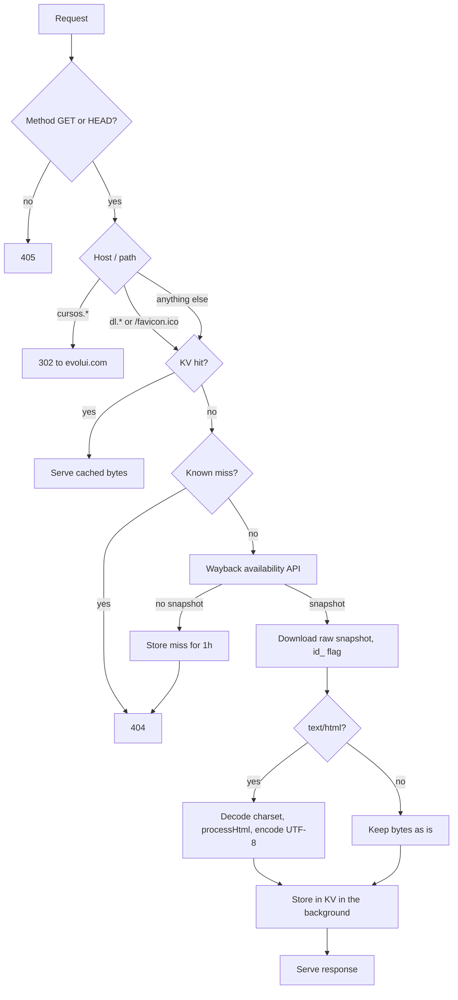
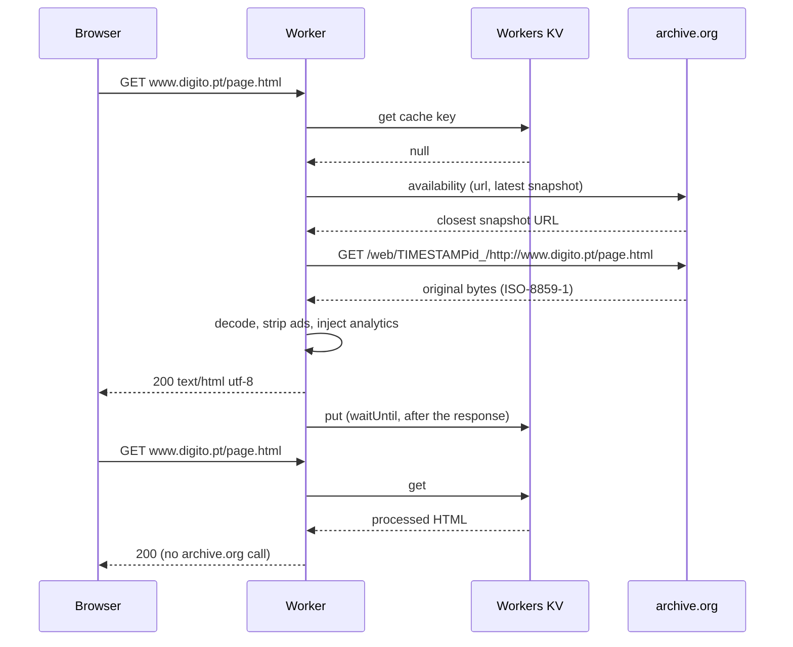
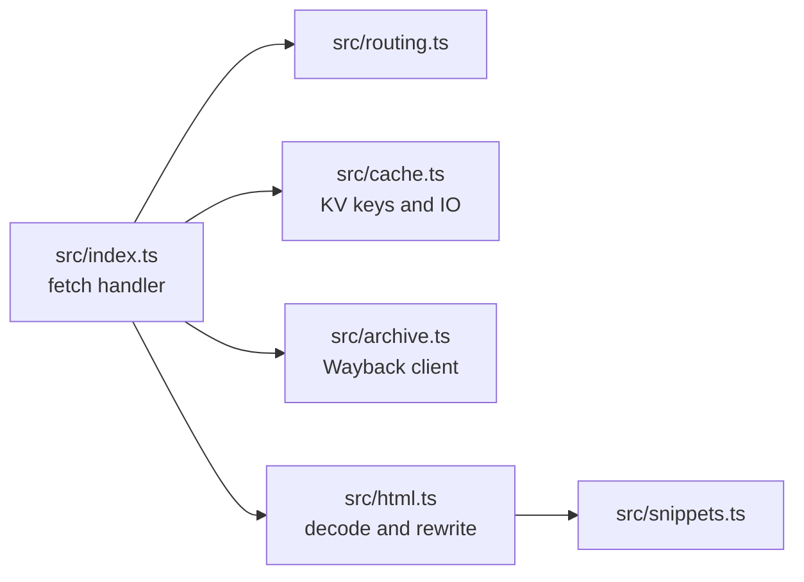

# Projet DIGITO.pt

## What is DIGITO.pt

digito.pt was a portuguese website and news portal about technology, telecoms, software, games and science, made by Prodigio late in the 1990s. It was then considered one of the biggest tech news sites in Portugal. It went dark along with Prodigio, but in 2025 I've recovered the domain and am building this project, recovering lost content from the Internet Archive database and allowing for search engines and AI engines to index it as one of the last "[low-background steel](https://lowbackgroundsteel.ai/)" sites, in the words of [Cloudflare](https://github.com/cloudflare)'s ex-CTO [John Graham-Cumming](https://github.com/jgrahamc).

Available at [digito.pt](https://www.digito.pt/)

## Project DIGITO

Cloudflare Worker that serves the retired digito.pt website from the Internet Archive (Wayback Machine). The first request for a URL is fetched from archive.org, cleaned up and stored in Workers KV; every later request is served straight from KV.

## How it works





### Behaviour

| Request | Origin looked up | Wayback timestamp |
| --- | --- | --- |
| `www.digito.pt/*` (pages) | `http://www.digito.pt/*` | latest snapshot |
| `dl.digito.pt/*` (assets) | `http://dl.digito.pt/*` | latest snapshot |
| `/favicon.ico` | `http://www.digito.pt/favicon.ico` | `ICO_TIMESTAMP` |
| `cursos.digito.pt/*` | none | 302 redirect to `https://www.evolui.com/` |

- The cache key includes the query string (old pages use `?id=`), is namespaced by kind and host, and is hashed when too long.
- HTML is decoded from its original charset (usually ISO-8859-1), processed, and stored as UTF-8. Non-HTML files found on `www` are stored untouched.
- HTML processing (`src/html.ts`): strip ads, footer and mailing-list blocks, swap the search form for Google site search, upgrade `dl.digito.pt` links to https, inject Clarity after `<head>` and Mailchimp before `</body>`. Google Tag Manager is not injected here, it is handled by the tag gateway.
- Misses are cached for one hour so unknown URLs do not hammer archive.org. archive.org errors (5xx, timeouts) are never cached and return 502.
- Missing images return a 1x1 transparent GIF with status 404.

## Project layout



## Development

```sh
npm install        # .npmrc sets legacy-peer-deps
npm run dev        # wrangler dev
npm run check      # typecheck + tests
```

Tests run inside workerd through `@cloudflare/vitest-plugin` against a local KV; archive.org is mocked, so they need no network.

## Configuration

`wrangler.toml` holds the route (`*.digito.pt/*`), the `ARC` KV binding and the `ICO_TIMESTAMP` var (the favicon is pinned to an early snapshot, everything else uses the latest). Wrangler environments do not inherit bindings or vars, so `env.staging` repeats them.

To invalidate everything already cached (for example after changing `processHtml` or a snippet), bump `CACHE_VERSION` in `src/cache.ts`. Old entries are simply never read again.

## Deployment

GitHub Actions (`.github/workflows`): pull requests run typecheck and tests; pushes to `dev` deploy to staging (`stg-digito`, on workers.dev) and pushes to `main` deploy to production, both only after the checks pass. Required repository secrets: `CLOUDFLARE_API_TOKEN` and `CLOUDFLARE_ACCOUNT_ID`.

Staging needs its own KV namespace: `npx wrangler kv namespace create ARC --env staging`, then put the id in `wrangler.toml`.

## License

[MIT](LICENSE). Reuse is welcome, keeping the copyright notice. The archived digito.pt content itself is not part of this repository and remains the property of its authors.

<details>
<summary>Old archive.org PHP script</summary>

Based on this first PHP code:

```php
<?php
$ga = <<<EOF
<script src="https://code.jquery.com/jquery-1.11.1.min.js"></script>
<script>
(function(i,s,o,g,r,a,m){i['GoogleAnalyticsObject']=r;i[r]=i[r]||function(){
(i[r].q=i[r].q||[]).push(arguments)},i[r].l=1*new Date();a=s.createElement(o),
m=s.getElementsByTagName(o)[0];a.async=1;a.src=g;m.parentNode.insertBefore(a,m)
})(window,document,'script','//www.google-analytics.com/analytics.js','ga');

ga('create', 'UA-XXXXXXXX-X', 'auto');
ga('send', 'pageview');

$(document).ready(function() {
    try {
        $('#wm-ipp-inside').find('td.r a[href="#close"]').click();
    } catch(err) {}

    $('a').on('click', function(e) {
        e.preventDefault();
        var url = $(this).prop('href').split('http://www.digito.pt');
        if ( url[1] ) {
            window.location.href=url[1];
        }
    });
});
</script>
</body>
EOF;

if ( $_SERVER['REQUEST_URI'] == '/' or $_SERVER['REQUEST_URI'] == '/index.html' ) {
    $wayUrl = 'http://web.archive.org/web/20030203134017/http://www.digito.pt/index.html';
} else {
    $wayJson = file_get_contents('http://archive.org/wayback/available?url=http://www.digito.pt' . $_SERVER['REQUEST_URI']);
    $wayArray = json_decode($wayJson, true);
    if ( !empty($wayArray['archived_snapshots']['closest']) ) {
        $wayUrl = $wayArray['archived_snapshots']['closest']['url'];
    }
}
if ( !empty($wayUrl) ) {
    $html = file_get_contents($wayUrl);
    $html = str_replace(array(
            '"/web/',
            '"/static/',
            '</body>'
        ), array(
            '"http://web.archive.org/web/',
            '"http://web.archive.org/static/',
            $ga
        ), $html
    );
    echo $html;
}
```
</details>
